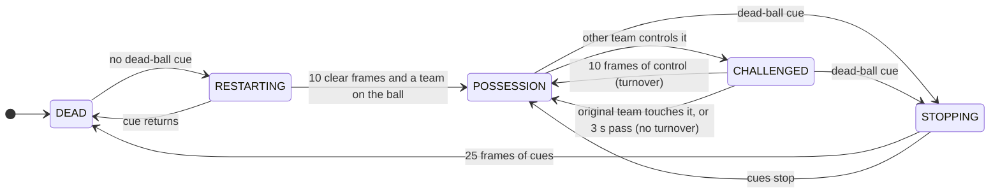

# Ball possession: state machine

Our entry for [More Than A Hack 2027](https://github.com/metrica-sports/more-than-a-hack-2027),
Phase 1: for every frame of FC Barcelona vs Athletic Club, say which team has the ball (`H` / `A`)
or that the ball is dead (`D`).

This first version reads the tracking data one frame at a time and runs a five-state machine over
it. It only changes its answer once the evidence has held for long enough, and then goes back and
relabels from the frame the change began. No model, no training, numpy only.

```bash
pip install -r requirements.txt
python run.py --data-dir /path/to/data --log output/changes.csv
```

`--data-dir` is the folder that holds `tactical/` from the organisers' download. It defaults to
`$MTAH_DATA_DIR`, then `./data`. The submission is written to `output/state_machine.csv`.

---

## How it works

Three steps. Each is one module and can be inspected on its own.

```
tracking.py         observations.py                  state_machine.py          submission.py
-----------         ---------------                  ----------------          -------------
ATD files    --->   per frame:                --->   per half:          --->   X outside the
in metres           controller  H / A / nobody       H / A / D labels          halves, checked
one row per         dead_cue    True / False         + a log of every          CSV, possession
video frame                                          change of label           count
```

### 1. Tracking (`possession/tracking.py`)

Reads the tactical ATD into arrays: ball position, every track slot's position and speed, and
which team each slot belongs to. Coordinates are converted from 0-1 units to metres (105.3 x
68.0). Row *i* is video frame *i*, which is also submission row *i*.

### 2. Observations (`possession/observations.py`)

Reduces each frame to two facts.

**Who controls the ball.** A team controls it when its player is the nearest, within 2 m, the ball
is moving slower than 7 m/s, and no opponent is about as close. Otherwise nobody does. For example,
with the ball moving at 3 m/s:

| nearest Barcelona | nearest Athletic | controller |
|---|---|---|
| 0.8 m | 4.1 m | `H` |
| 1.2 m | 1.4 m | nobody: contested |
| 3.0 m | 5.0 m | nobody: no one close |
| 0.8 m, ball at 15 m/s | 4.1 m | nobody: a pass in flight |

Short ball gaps (0.5 s or less) are filled by a straight line first. Longer gaps stay missing.

**Does it look like a stoppage.** Yes when the ball is more than 1 m off the pitch, or when the
players have slowed to an average under 1.5 m/s *and* the ball is missing or not moving.

### 3. The state machine (`possession/state_machine.py`)



`RESTARTING`, `CHALLENGED` and `STOPPING` are "maybe" states. While in one, the machine keeps
writing the old label. If the change is confirmed, it rewrites the labels from the frame the
maybe-state began. If not, nothing is rewritten.

An example, one letter per frame (`h` home controls, `a` away controls, `.` nobody), starting in
home possession and needing 3 frames of control for a turnover:

```
frame      0 1 2 3 4 5 6 7 8 9 0 1 2 3 4 5
observed   h h . . a . h h . . a a . a h h
written    H H H H H H H H H H A A A A A A
                   ^           ^     ^
                   |           |     frame 13: third away frame, turnover confirmed
                   |           frame 10: so A is written from here, away's first touch
                   frame 4: away touches it once, home gets it back. No change.
```

How that maps to the possession rules in the organisers' CHALLENGE.md:

| situation | what the machine does |
|---|---|
| pass between teammates | ball in flight is "nobody", the receiver is the same team: no change |
| loose or contested ball | "nobody" is never evidence for a change: stays with the last team |
| deflection, touch without control | a short challenge that never reaches 10 frames: no change |
| interception | 10 frames of control: turnover, starting at the first touch |
| ball out, foul, set piece | 1 s of stoppage cues: `D`, starting at the first cue |
| `H D H` | two possessions, as the ranking metric counts them |

### 4. The submission (`possession/submission.py`)

Writes `X` outside the two graded halves (frames 11185-90651 and 110808-190197), checks the file
against the submission contract and writes it. It also counts the possessions the file claims.
That count is the first thing to look at. The public 5 minutes have 17 possessions, about 3.4 a
minute, so a full match should be in the hundreds, not the thousands.

---

## Parameters

Every threshold is in `possession/config.py`, in one `Params` object, with a comment saying what
it means on the pitch. To try a different value:

```python
from possession.config import Params
Params(confirm_turnover=20)        # a turnover now needs 0.8 s of control
```

The values come from football reasoning, not from the ground truth. The rules forbid tuning on the
public 5 minutes, and the organisers' EVALUATION.md shows it picks the wrong value anyway.

## Checking the output

```bash
python run.py --log output/changes.csv
```

`output/changes.csv` has one row per change of label. These example rows come from a test run on invented data:

```
confirmed_frame,start_frame,label,reason
11194,11185,H,restart
11508,11499,A,turnover
```

`start_frame` is where the new label begins after backdating, and `confirmed_frame` is where the
machine became sure. Open the video at `start_frame` (frame / 25 = seconds) to see whether the
change is real.

Then run the organisers' tools, from a clone of their repository:

```bash
python evaluation/validate_submission.py /path/to/output/state_machine.csv
python evaluation/run_evaluation.py         # scores files in evaluation/results/ on the public 5 minutes
```

The public score is a pipeline check, not a ranking. Seventeen possessions cannot tell two
versions apart.

## Tests

```bash
python -m unittest
```

The tests use hand-written frame sequences and a small invented passage of play. None of them use
match data, so they run on a fresh clone. `tests/test_state_machine.py` has one test per rule in
the table above.

## Known gaps

- **Dead-ball timing is approximate.** Player speed is averaged over one second, so a stoppage or
  restart can be placed a few frames off. A restart is really the frame the ball is struck, and
  that could be found from the ball's speed.
- **Long ball gaps carry the last team.** If a turnover happens while the ball is untracked, it is
  only picked up when the new team is seen on the ball.
- **Smart Tagging is not used yet.** Its set pieces mark restarts, and its team tags are a second
  opinion on who has the ball.
- **Thresholds are fixed.** Whether 2 m and 10 frames are right needs checking against the video.

## Data and rules

The match data is not in this repository and must never be. `.gitignore` excludes `data/`,
`cache/` (the parsed tracking) and `output/` (submissions and logs). No labels in this pipeline
come from a person: every one is produced by the code from the tracking data.
