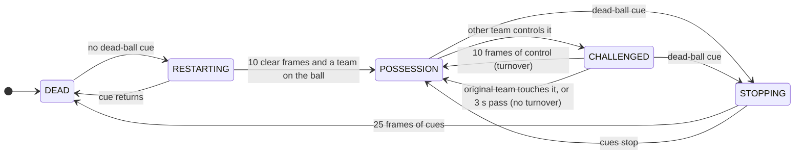

# state_machine

Turns the per-frame observations into one `H` / `A` / `D` label per frame.

It reads the match one frame at a time, the way you would watch it, and keeps track of what state
play is in. It only changes its mind when the evidence has held for long enough, and when it does,
it goes back and relabels from the moment the change actually started. That second part,
backdating, is what stops every hand-over landing late.

```python
from possession.config import Params
from possession.state_machine import PossessionMachine

machine = PossessionMachine(Params())
labels = machine.run(controller, dead_cue)        # numpy array of "H", "A", "D"
for change in machine.changes:                    # every confirmed change, for debugging
    print(change)
```

Run it once per half. A new machine starts in `DEAD`, which is right for both halves: each opens
with a kickoff.

---

## The five states

| state | label written | meaning |
|---|---|---|
| `DEAD` | `D` | the ball is out of play |
| `RESTARTING` | `D` for now | dead-ball cues have stopped; waiting to be sure play is live |
| `POSSESSION` | the team | one team has the ball |
| `CHALLENGED` | the team | the other team has touched it; waiting to see if they keep it |
| `STOPPING` | the team | dead-ball cues have started; waiting to be sure play has stopped |

`RESTARTING`, `CHALLENGED` and `STOPPING` are "maybe" states. While in one, the machine keeps
writing the old label. If the change is confirmed, it overwrites everything from the frame the
maybe-state began. If not, the old labels were right all along and nothing is overwritten.



## Transitions

| from | to | when | backdated to |
|---|---|---|---|
| `DEAD` | `RESTARTING` | a frame with no dead-ball cue | |
| `RESTARTING` | `DEAD` | a cue comes back before the restart is confirmed | |
| `RESTARTING` | `POSSESSION` | 10 clear frames, and some team has controlled the ball | the first clear frame |
| `POSSESSION` | `CHALLENGED` | the other team controls the ball | |
| `POSSESSION` | `STOPPING` | a dead-ball cue | |
| `CHALLENGED` | `POSSESSION`, new team | the challenger has controlled it for 10 frames in total: a turnover | the challenger's first touch |
| `CHALLENGED` | `POSSESSION`, same team | the original team touches it again: no turnover | nothing changes |
| `CHALLENGED` | `POSSESSION`, same team | the challenger has not touched it for 3 s: no turnover | nothing changes |
| `CHALLENGED` | `STOPPING` | a dead-ball cue | |
| `STOPPING` | `DEAD` | dead-ball cues for 25 frames | the first cue |
| `STOPPING` | `POSSESSION` | the cues stop first: play carried on | nothing changes |

The frame counts are the defaults in `config.Params`. The challenger's 10 frames do not have to be
consecutive: control, a loose ball, then control again all count, as long as the original team
does not touch it in between.

If the restart has no team yet (play is clear but nobody has been seen on the ball), it waits. When
a team is first seen on the ball, the whole wait is labelled as theirs.

---

## Worked example

One letter per frame. `h` = home controls, `a` = away controls, `.` = nobody. The machine starts
in home possession, and needs 3 frames of control for a turnover to keep the example short:

```
frame      0 1 2 3 4 5 6 7 8 9 0 1 2 3 4 5
observed   h h . . a . h h . . a a . a h h
state      P P P P C C P P P P C C C P C C      P = POSSESSION, C = CHALLENGED
written    H H H H H H H H H H A A A A A A
                   ^           ^     ^
                   |           |     frame 13: the third away frame confirms the turnover
                   |           frame 10: so A is written from here, away's first touch
                   frame 4: away touches it once, home gets it back. No change.
```

The first `a` was a deflection: home got the ball straight back, so nothing was rewritten. The
second challenge reached three away frames, so the possession switches, starting from the frame
away first touched it. The `h` after that is now a challenge by home against away.

This exact sequence is a test: `tests/test_state_machine.py`, `WorkedExampleTest`.

## How this follows the possession rules

From the organisers' CHALLENGE.md:

| situation | what the machine does |
|---|---|
| pass between teammates | the ball in flight is `NOBODY`, the receiver is the same team: never leaves `POSSESSION` |
| loose or contested ball | `NOBODY` is never evidence for a change: stays with the last team |
| touch or deflection without control | a short `CHALLENGED` that never reaches 10 frames, then back with no trace |
| interception | 10 frames of control: turnover, starting at the first touch |
| ball out, foul, set piece | 1 s of cues: `D`, starting at the first cue |
| `H D H` | two possessions, which is how the ranking metric counts them |
| dead ball | `DEAD` always writes `D`, with no team, as the ground truth does |

---

## The change log

`machine.changes` lists every confirmed change, as `Change` records:

| field | meaning |
|---|---|
| `frame` | the frame where the machine became sure |
| `start` | the frame the new label was written from, after backdating. Never later than `frame` |
| `label` | the new label: `H`, `A` or `D` |
| `reason` | `restart`, `turnover` or `stoppage` |

`run(..., offset=11185)` adds the offset to both frame numbers, so a half that starts at video
frame 11185 reports video frames rather than positions within the half. `run.py --log` writes
these to a CSV.

## Stepping by hand

`step(controller, dead_cue)` processes one frame. `run` is a loop over `step`. Use `step` to watch
the state change frame by frame:

```python
machine = PossessionMachine(Params())
for team, cue in zip(controller, dead_cue):
    machine.step(int(team), bool(cue))
    print(machine.state, machine.labels[-1])
```

`machine.labels` is a list, and earlier entries can still be rewritten while a maybe-state is
open. Read it once the half is finished.
